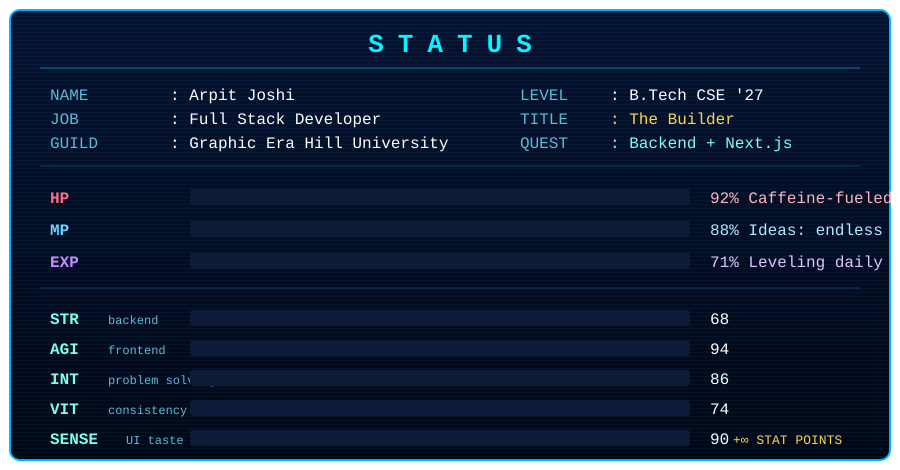

<div align="center">



<a href="https://git.io/typing-svg">
  
</a>

<br/>


<br/><br/>

<a href="https://arpit-io-ic4j.vercel.app/"></a>
<a href="https://www.linkedin.com/in/arpit-joshi-999a58282"></a>
<a href="mailto:arpitjoshi564@gmail.com"></a>
<a href="https://evotimes.xyz"></a>

</div>

<br/>

<div align="center">



</div>

<br/>

<div align="center">



</div>

<br/>

<div align="center">



</div>

---

## 🏰 Dungeons Cleared

<table>
<tr>
<td width="50%" valign="top">

### 🔴 The Living Book
**Pop-up storybook portfolio.** Pages turn, chapters pop out in 3D, each project is its own chapter.
`Next.js` `CSS 3D` `Animation`

</td>
<td width="50%" valign="top">

### 🟠 Huntio
**Camera-based object-hunt party game.** Point your camera, find the item first. Detection runs in the browser.
`Next.js` `Node.js` `YOLO11n` `WebSockets`

</td>
</tr>
<tr>
<td width="50%" valign="top">

### 🟡 EvoTimes
**Live news site: [evotimes.xyz](https://evotimes.xyz).** Frontend on Vercel, backend on Render, SEO-tuned.
`React` `Node.js` `Express`

</td>
<td width="50%" valign="top">

### 🟢 TaskFlow
**Task and productivity app.** Clean flows, fast UI.
`React` `Node.js` `MongoDB`

</td>
</tr>
<tr>
<td width="50%" valign="top">

### 🔵 API Master
**API testing and exploring tool.** Built because Postman tabs got out of hand.
`JavaScript` `Node.js` `Express`

</td>
<td width="50%" valign="top">

### ⚪ TypingKing
**Typing speed game.** Speed, accuracy, bragging rights.
`HTML` `CSS` `JavaScript`

</td>
</tr>
</table>

```text
[ ⚠ UNSTABLE GATES DETECTED ]
  > Collaborative browser IDE ........ [ PREPARING ]
  > AI documentation structurer ...... [ PREPARING ]
  > More gates are opening soon ...... [ ??? ]
```

---

## 🗡️ Shadow Army

<div align="center">

<br/>


</div>

<details>
<summary><b>🌑 Click to see what's being trained next</b></summary>
<br/>

```text
[ EXTRACTION IN PROGRESS ]
  Next.js depth ........... ████████░░  in progress
  Backend architecture .... ███████░░░  in progress
  WebSockets .............. ██████░░░░  in progress
  System design ........... █████░░░░░  in progress
  Docker .................. ██░░░░░░░░  queued
```

</details>

---

## 📊 Player Analysis

<div align="center">


<br/>


</div>


<div align="center">
<picture>
  <source media="(prefers-color-scheme: dark)" srcset="https://raw.githubusercontent.com/arpitjoshi24/arpitjoshi24/output/github-snake-dark.svg" />
  <source media="(prefers-color-scheme: light)" srcset="https://raw.githubusercontent.com/arpitjoshi24/arpitjoshi24/output/github-snake.svg" />
  
</picture>
</div>

---

## 🔐 Secret Terminal

<details>
<summary><b>Do not open this</b></summary>
<br/>

```bash
arpit@github:~$ sudo hire arpit
[sudo] password for recruiter: ********
Access granted.

> Skills loaded ........... OK
> Coffee level ............ CRITICAL
> Commit streak ........... ALIVE
> Ideas in backlog ........ 99+
> Ready to join your team . TRUE

arpit@github:~$ echo "Let's build something."
Let's build something.
```

📫 **arpitjoshi564@gmail.com**

</details>

---

<div align="center">


</div>